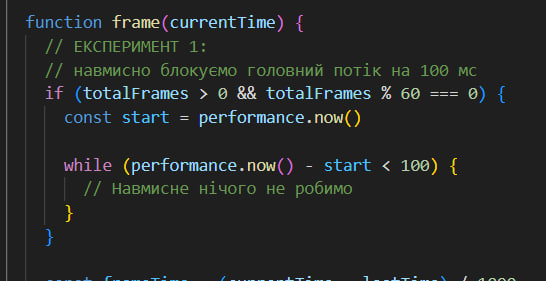
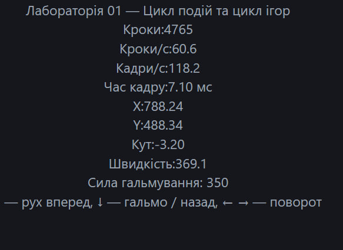
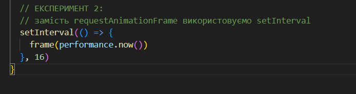
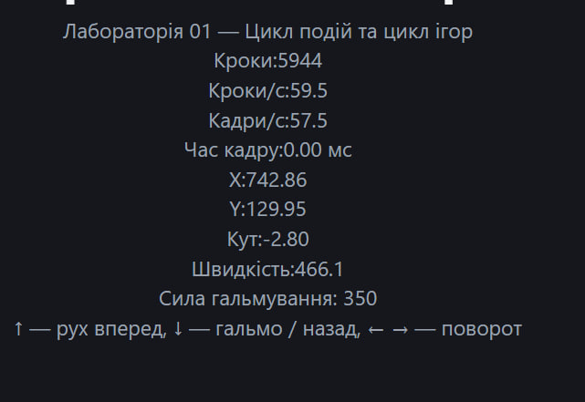
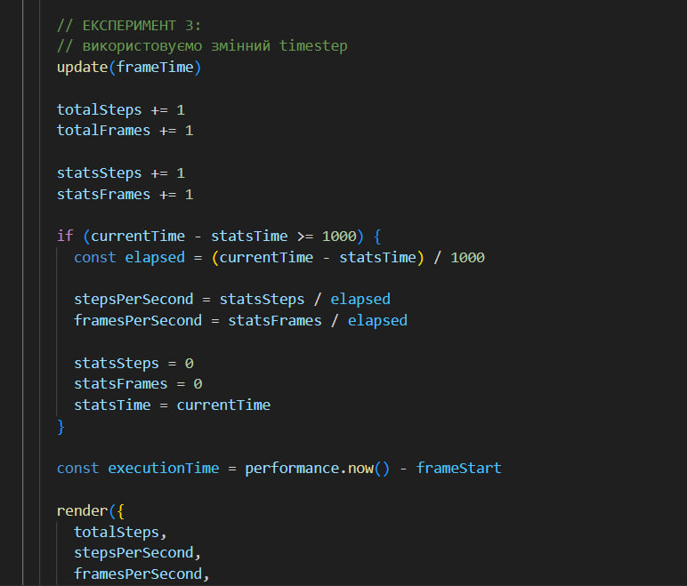
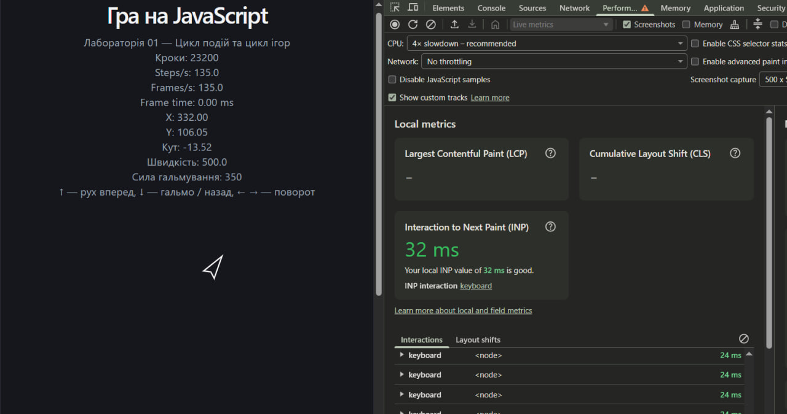
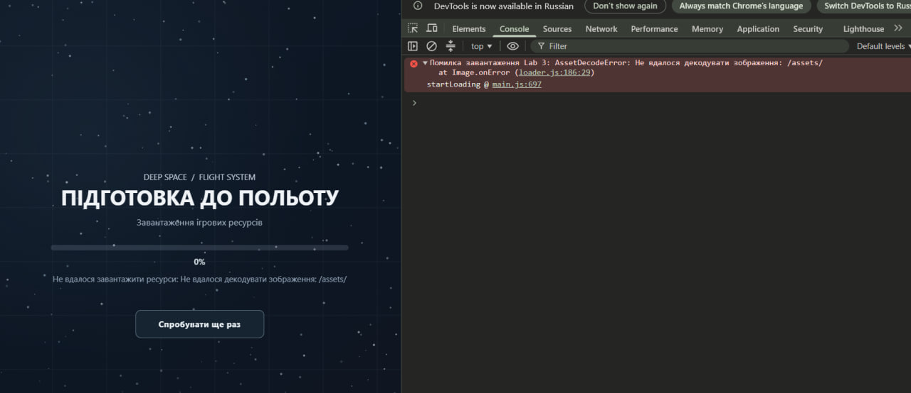
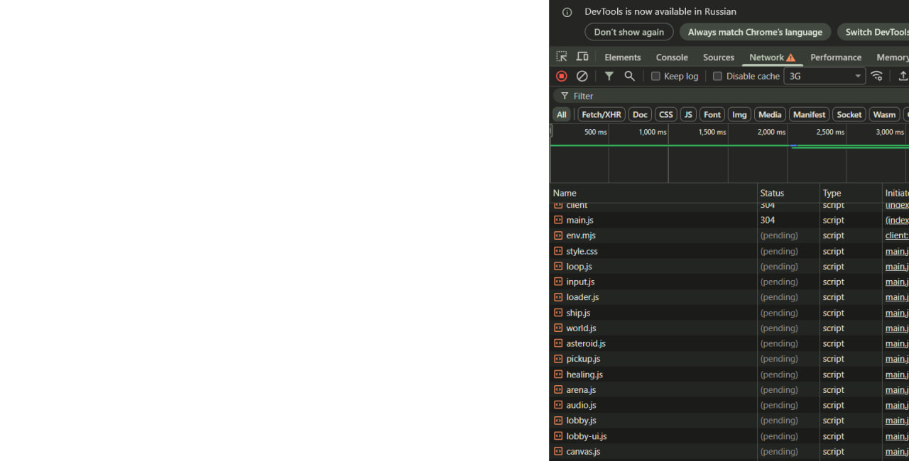
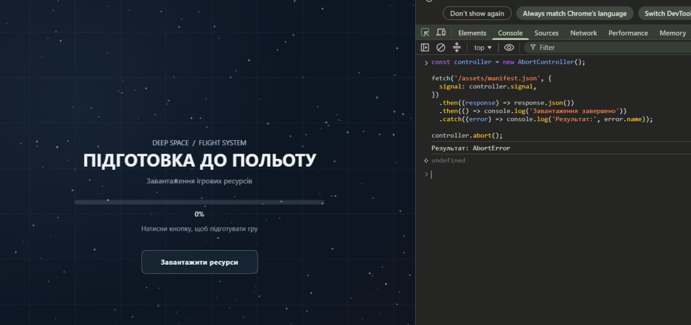
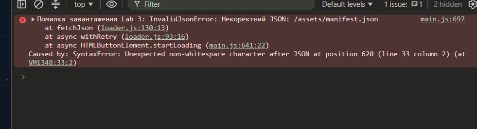

# Multiplayer Game — Lab 01

**Лабораторна робота №1 — Цикл подій та цикл ігор**

**Мета лабораторної роботи**

Дослідити принципи виконання JavaScript у браузері, роботу Event Loop, `requestAnimationFrame`, черг задач, ES-модулів, Canvas 2D API та реалізувати ігровий цикл із фіксованим кроком симуляції.

У межах лабораторної роботи створено прототип браузерної гри на JavaScript, у якій гравець керує літаком за допомогою клавіатури.

---

**Технології**

- JavaScript
- Vite
- HTML5 Canvas 2D
- ESLint
- Prettier
- `requestAnimationFrame`
- ES Modules

**Запуск проєкту**

Встановити залежності:

```bash
npm install
```

**Структура проєкту**

```text
src/
├── render/
│   ├── canvas.js
│   └── draw.js
├── sim/
│   ├── arena.js
│   └── ship.js
├── input.js
├── loop.js
├── main.js
└── style.css
```

**Опис основних файлів**

**`main.js`**

Головний файл програми. Створює Canvas, корабель, систему введення та запускає ігровий цикл. Також оновлює HUD із показниками симуляції та координатами корабля.

**`loop.js`**

Містить функцію `createLoop()`.

Ігровий цикл використовує `requestAnimationFrame` та accumulator.

Симуляція виконується з фіксованим кроком:

```js
const FIXED_DT = 1 / 60
```

Тобто фізика виконується 60 разів на секунду незалежно від частоти оновлення монітора.

**`input.js`**

Містить `createInput()`.

Стан натиснутих клавіш зберігається у замиканні за допомогою `Set`.

Фізика може перевіряти стан клавіш через:

```js
input.isDown('ArrowUp')
```

Стрілки використовуються для керування літаком.

**`sim/ship.js`**

Містить фізику корабля.

Основна функція:

```js
integrate(ship, input, dt)
```

Виконує:

- поворот;
- прискорення;
- гальмування;
- рух назад;
- обмеження максимальної швидкості;
- оновлення координат.

Функція не має залежностей від DOM.

**`sim/arena.js`**

Містить логіку арени.

Функція `wrapPosition()` реалізує загортання країв: якщо літак вилітає за одну сторону арени, він з'являється з протилежної.

**`render/canvas.js`**

Створює Canvas і враховує `devicePixelRatio`.

Це дозволяє коректно відображати Canvas на екранах із високою щільністю пікселів.

**`render/draw.js`**

Містить функцію малювання літака на Canvas.

Під час рендерингу використовується інтерполяція між попередньою та поточною позиціями корабля.

---

**Ігровий цикл**

Основна схема роботи програми:

```text
requestAnimationFrame
        ↓
      frame()
        ↓
  накопичення часу
        ↓
   fixed timestep
        ↓
     update()
        ↓
   integrate()
        ↓
     physics
        ↓
     render()
        ↓
      Canvas
```

Фіксований крок симуляції:

```text
1 / 60 ≈ 0.01667 секунди
```

При цьому частота рендерингу може бути іншою.

Наприклад:

```text
Steps/s  ≈ 60
Frames/s ≈ 144
```

Таким чином, на моніторі з частотою 144 Hz рендеринг може виконуватися 144 рази на секунду, але фізика залишається стабільною — 60 кроків на секунду.

**Інтерполяція**

Для плавного відображення положення корабля використовується коефіцієнт `alpha`.

Під час фізичного оновлення зберігається попередня позиція:

```js
ship.previousX = ship.x
ship.previousY = ship.y
```

Під час рендерингу використовується проміжна позиція:

```js
renderX = previousX + (x - previousX) * alpha
renderY = previousY + (y - previousY) * alpha
```

Це дозволяє плавніше відображати рух корабля, коли частота рендерингу вища за частоту симуляції.

**HUD**

На екрані відображаються:

- кількість виконаних кроків;
- Steps/s;
- Frames/s;
- час між кадрами;
- координати X та Y;
- кут повороту;
- поточна швидкість.

Приклад нормальної роботи:

```text
Steps/s: 60.0
Frames/s: 144.0
Frame time: ≈ 6.94 ms
```

Значення Steps/s залишається близьким до 60 навіть при іншій частоті кадрів.

**Керування**

- ↑ — рух вперед;
- ↓ — гальмування / рух назад;
- ← — поворот вліво;
- → — поворот вправо.

Для стрілок використовується `preventDefault()`, тому під час керування сторінка не прокручується.

---

**Експерименти M4**

У лабораторній роботі було виконано три експерименти, у яких ігровий цикл навмисно змінювався для дослідження його поведінки.

**Експеримент 1 — блокування головного потоку**


**Зміна**

До функції кадру було додано навмисний блокуючий цикл, який виконується кожен 60-й кадр та займає головний потік приблизно на 100 мс.




**Результат**

Під час виконання busy-wait гра періодично працює менш плавно. Виникають затримки обробки подій та ривки відображення.

На одному з вимірювань HUD показував:

- Steps/s: 60.6;
- Frames/s: 118.2;
- Frame time: 7.10 мс.



Показники HUD залежать від моменту, коли було зроблено скриншот, оскільки блокування виконується лише кожен 60-й кадр.

**Пояснення**

JavaScript у браузері виконує синхронний код у головному потоці. Поки виконується цикл `while`, Event Loop не може перейти до наступної задачі.

Тому під час блокування не можуть нормально виконуватися:

- наступні виклики `requestAnimationFrame`;
- обробка нових подій;
- оновлення інтерфейсу;
- інші задачі Event Loop.

Синхронний блок тривалістю 100 мс неможливо «обійти» в тому самому потоці JavaScript. Наступна задача може бути виконана лише після завершення блокуючого коду.

Після завершення експерименту busy-wait було видалено.

**Експеримент 2 — `setInterval` замість `requestAnimationFrame`**

**Зміна**

`requestAnimationFrame` було тимчасово замінено на `setInterval` з інтервалом 16 мс.



**Результат**

Під час експерименту було отримано різні значення частоти кадрів. В одному вимірюванні:

- Steps/s: 59.5;
- Frames/s: 62.5;
- Frame time: 0.10 мс.



Отримані значення показують, що `setInterval(frame, 16)` не гарантує стабільні 60 кадрів/с.

Реальна частота викликів залежить від роботи Event Loop, навантаження браузера та інших задач. При переході вкладки у фоновий режим браузер також може обмежувати виконання таймерів. Тому `setInterval` не є оптимальним механізмом для ігрового рендерингу.

`requestAnimationFrame` краще підходить для рендерингу, оскільки браузер синхронізує його виконання з оновленням екрана.

Після завершення експерименту `requestAnimationFrame` було відновлено.

**Експеримент 3 — змінний timestep**

**Зміна**

Фіксований крок симуляції:

```js
update(FIXED_DT)
```

було тимчасово замінено на:

```js
update(frameTime)
```

У такому варіанті симуляція виконується один раз за кадр, а `dt` залежить від фактичної тривалості кадру.



**Перевірка продуктивності**

Для експерименту використовувався CPU throttling у Chrome DevTools.



Під час першого вимірювання було використано CPU slowdown. При змінному timestep результат фізичної симуляції залежить від тривалості конкретного кадру. Якщо кадр виконується довше, значення `dt` збільшується, тому за один крок корабель переміщується на більшу відстань.

Через це при різній продуктивності пристрою траєкторія корабля може відрізнятися.

**Порівняння**

При змінному timestep:

```text
dt = час між поточним та попереднім кадром
```

Тому фізика залежить від частоти кадрів.

При фіксованому timestep:

```text
dt = 1 / 60
```

Тому фізика виконується однаковими кроками незалежно від частоти рендерингу.

Після завершення експерименту було відновлено акумулятор часу та фіксований timestep.

Це робить поведінку симуляції стабільнішою та менш залежною від продуктивності пристрою.

---

**Порівняння експериментів**

| Експеримент | Зміна | Результат |
|---|---|---|
| Blocking loop | Синхронне блокування на 100 мс | Затримки та ривки гри |
| `setInterval` | Таймер замість `requestAnimationFrame` | Частота кадрів не є стабільною |
| Variable timestep | `update(frameTime)` замість fixed timestep | Фізика залежить від тривалості кадру |
| Нормальний режим | `requestAnimationFrame` + fixed timestep | Стабільна симуляція приблизно 60 steps/s |

**Event Loop**

JavaScript використовує Event Loop для керування виконанням синхронного коду та асинхронних задач.

Спрощено роботу можна представити як:

```text
Call Stack → Task / Microtask queues → Event Loop → наступне виконання
```

Якщо головний потік зайнятий довгою синхронною операцією, Event Loop не може своєчасно обробити наступні задачі.

Саме це було продемонстровано під час першого експерименту з блокуючим циклом.

`requestAnimationFrame` дозволяє планувати виконання рендерингу відповідно до циклу оновлення браузера, тому він краще підходить для анімацій та браузерних ігор.
Висновок:
У ході лабораторної роботи було досліджено принципи роботи циклу подій JavaScript та ігрового циклу. Було реалізовано фіксований timestep із використанням requestAnimationFrame, обробку введення користувача та відображення статистики роботи гри. Також проведено експерименти з блокуванням головного потоку, setInterval та змінним timestep. Експерименти показали вплив способу організації циклу на FPS, час кадру та стабільність руху об'єктів.

**Висновок**

У ході лабораторної роботи було досліджено принципи роботи циклу подій JavaScript та ігрового циклу. Було реалізовано фіксований timestep із використанням `requestAnimationFrame`, обробку введення користувача та відображення статистики роботи гри. Також проведено експерименти з блокуванням головного потоку, `setInterval` та змінним timestep. Експерименти показали вплив способу організації циклу на FPS, час кадру та стабільність руху об'єктів.
>>>>>>> Stashed changes
# Лабораторна робота №2

**Об'єкти, прототипи та `this`: модель сутностей**

**Мета роботи**

Розширити гру з лабораторної роботи №1 за допомогою об'єктів, класів, наслідування, композиції та `Map`. Реалізувати модель ігрових сутностей, стрільбу, колізії, пошкодження, вибухи, респаун, рахунок та додаткові можливості через композицію.

---

**1. Vector2 та Entity**

Для роботи з координатами та швидкостями створено клас `Vector2`.

Реалізовані чисті методи:

- `add()` — додавання векторів;
- `sub()` — віднімання;
- `scale()` — множення на число;
- `length()` — довжина;
- `normalize()` — нормалізація;
- `rotate()` — поворот;
- `dot()` — скалярний добуток;
- `Vector2.fromAngle()` — створення вектора за кутом.

Методи `Vector2` не змінюють початковий вектор, а повертають новий об'єкт.

Базовий клас `Entity` містить такі властивості:

- `id`;
- `pos`;
- `vel`;
- `angle`;
- `radius`;
- `alive`;
- `kind`;
- `update(dt)`.

Унікальний ID створюється за допомогою приватного лічильника `#nextId` та приватного поля `#id`. Доступ до ID здійснюється через getter `id`.

---

**2. Ship та наслідування**

Корабель з лабораторної роботи №1 було перетворено на клас `Ship`, який успадковує `Entity`.

Використовується лише один рівень наслідування.

`Ship` успадковує базові властивості `Entity` та реалізує власну поведінку:

- керування;
- поворот;
- прискорення;
- гальмування;
- обмеження швидкості;
- стрільбу;
- HP.

Інші сутності також використовують `Entity` як базовий клас:

- `Ship`;
- `Bullet`;
- `Asteroid`;
- `Pickup`;
- `Explosion`.

Глибокої ієрархії класів немає.

---

**3. World та Map**

Для зберігання всіх ігрових сутностей використовується `Map`, де ключем є ID сутності.

Клас `World` реалізує:

- `spawn(entity)` — додавання сутності;
- `despawn(id)` — позначення сутності як мертвої;
- `get(id)` — пошук за ID;
- `[Symbol.iterator]` — ітерацію по сутностях;
- `ofKind(kind)` — генератор для отримання сутностей певного типу;
- `step(dt, input)` — оновлення світу.

Видалення є відкладеним: сутність спочатку отримує `alive = false`, після чого наприкінці `World.step()` виконується sweep і мертві сутності видаляються з `Map`.

---

**4. Кулі та стрільба**

Клас `Bullet` успадковує `Entity`.

Куля має:

- швидкість;
- радіус;
- шкоду;
- TTL (`time to live`).

Після завершення TTL куля стає неактивною.

Метод `Ship.fire()` створює кулю перед кораблем у напрямку його носа. При цьому до швидкості кулі додається поточна швидкість корабля.

Керування:

- `Space` — звичайний постріл;
- `H` — самонавідна куля.

---

**5. Проблема з `this`**

Проблема виникає, якщо метод класу передати як callback, наприклад `window.addEventListener('keydown', ship.fire)`.

У цьому випадку передається сама функція, а не виклик методу як `ship.fire()`. Тому `this` визначається способом виклику callback і може бути неправильним.

Основні правила `this`:

1. При використанні `new` `this` є новим створеним об'єктом.
2. При явному виклику `call()`, `apply()` або `bind()` `this` задається явно.
3. При неявному виклику `object.method()` `this` є об'єктом `object`.
4. При звичайному виклику функції в strict mode `this` дорівнює `undefined`.

Стрілочні функції не мають власного `this` і використовують `this` із зовнішнього контексту.

У проєкті проблема виправлена за допомогою wrapper-функції. Замість прямої передачі `ship.fire` використовується callback, який викликає `ship.fire(world)`.

Також можливими способами виправлення є використання `ship.fire.bind(ship)` або стрілочного поля класу.

---

**6. Астероїди та колізії**

`Asteroid` є сутністю з власними:

- координатами;
- швидкістю;
- радіусом;
- HP.

Колізії винесені в окрему систему `collision.js`.

Основна перевірка — зіткнення двох кіл. Два об'єкти вважаються такими, що зіткнулися, якщо відстань між їхніми центрами не перевищує суму їхніх радіусів.

Для пошуку пар використовується наївний алгоритм `O(n²)`, що достатньо для поточної кількості сутностей у грі.

Окремо обробляються колізії:

- куля → астероїд;
- куля → корабель;
- корабель → астероїд;
- корабель → pickup.

Кулі завдають шкоди кораблям та астероїдам.

---

**7. Приватне HP, вибухи, respawn та score**

HP корабля зберігається у приватному полі `#hp`.

Для доступу до HP використовується getter `hp`.

При отриманні шкоди значення HP зменшується. Якщо HP досягає нуля, корабель стає неактивним.

При знищенні корабля створюється `Explosion`.

`Explosion` містить частинки, які існують обмежений час і поступово зникають.

Після знищення корабля через 2 секунди створюється новий корабель у випадковій безпечній точці.

За знищення астероїда збільшується рахунок. За кожен знищений астероїд нараховується 100 очок.

Рахунок та HP відображаються на HUD.

---

**8. Композиція: Homing та Pickup**

**Чому не глибока ієрархія?**

Якби реалізовувати homing тільки через наслідування, могла б виникнути структура з окремими класами `HomingBullet` та `HomingAsteroid`.

Такий підхід створює зайві класи та прив'язує додаткову поведінку до конкретного типу об'єкта.

Наприклад, якщо пізніше знадобиться самонавідна поведінка для іншої сутності, доведеться створювати ще один клас.

Тому для додаткової поведінки використовується композиція.

**Homing**

У модулі `homing.js` створюється поведінка `createHoming(target)`.

Вона має метод `update(entity, dt)`, який змінює швидкість об'єкта в напрямку цілі.

Поведінка передається сутності як окремий об'єкт. Тому одна й та сама поведінка може бути підключена до кулі або астероїда без створення нових класів.

У грі клавіша `H` створює самонавідну кулю, яка прямує до астероїда.

**Pickup**

`Pickup` не є `Ship` і не успадковує його поведінку.

Pickup:

- залишається нерухомим;
- має радіус колізії;
- взаємодіє з кораблем;
- має окрему поведінку.

Для поточної реалізації використовується лікувальна поведінка `createHealing(25)`.

Вона передається в `Pickup` як об'єкт поведінки.

При зіткненні pickup застосовує цю поведінку до корабля та відновлює його HP.

Таким чином, механіку pickup можна змінювати без створення нових класів-нащадків.

---

**9. Експеримент з прототипами**

У JavaScript методи класів знаходяться у `prototype`.

Для створеного через `new Ship()` об'єкта ланцюжок прототипів має вигляд:

`ship → Ship.prototype → Entity.prototype → Object.prototype → null`

Наприклад, при зверненні до `ship.update` JavaScript спочатку шукає властивість у самому об'єкті `ship`, потім у `Ship.prototype`, а потім у `Entity.prototype`.

Це показує, що методи класів не копіюються в кожен об'єкт окремо, а знаходяться у відповідному прототипі.

---

**10. Результат**

У лабораторній роботі реалізовано:

- `Vector2` з чистими методами;
- базовий `Entity`;
- `Ship extends Entity`;
- `Bullet` з TTL;
- `Asteroid`;
- `Pickup`;
- `Explosion`;
- `World` на основі `Map`;
- ітерацію по `World`;
- генератор `ofKind()`;
- відкладене видалення сутностей;
- стрільбу з носа корабля;
- виправлення проблеми з `this`;
- систему circle-circle колізій `O(n²)`;
- приватне `#hp` та `get hp()`;
- пошкодження кораблів та астероїдів;
- вибухи з частинок;
- respawn через 2 секунди;
- score на HUD;
- homing через композицію;
- pickup через композицію.

---

**Reflection**

**1. Чому виникла проблема з `this`?**

`this` визначається способом виклику функції, а не місцем, де метод був оголошений.

При передачі `ship.fire` як callback метод викликається вже не як `ship.fire()`, тому `this` може бути неправильним.

Проблему можна виправити за допомогою wrapper-функції, `bind()` або стрілочного поля класу.

**2. Чому Map, а не звичайний об'єкт?**

`Map` зручний для зберігання ігрових сутностей, тому що:

- дозволяє використовувати числові ID без перетворення;
- має властивість `.size`;
- підтримує безпосередню ітерацію;
- не має проблеми з успадкованими властивостями звичайного об'єкта;
- зручний для додавання та видалення сутностей.

**3. Чому композиція краща для homing?**

Homing є поведінкою, а не окремим видом сутності.

Його можна підключити до кулі або астероїда без створення окремих класів `HomingBullet` та `HomingAsteroid`.

Це дозволяє уникнути глибокої ієрархії класів та повторення коду.

---

**Керування**

| Клавіша | Дія |
|---|---|
| `↑` | рух вперед |
| `↓` | гальмування / рух назад |
| `←` | поворот ліворуч |
| `→` | поворот праворуч |
| `Space` | звичайний постріл |
| `H` | самонавідний постріл |

---

**Висновок**

Під час лабораторної роботи гру з Lab 1 було переведено на модель сутностей із використанням класів та одного рівня наслідування. Для зберігання сутностей використано `Map`, для вибірки за типом — генератор `ofKind()`, а для додаткової поведінки — композицію. Було реалізовано стрільбу, колізії, пошкодження, вибухи, респаун, рахунок, homing та pickup. Також було розглянуто правила роботи `this` та виправлено проблему з передаванням методу класу як callback.
---

# Лабораторна робота №3

**Асинхронний JavaScript: Promises, async/await і екран завантаження**

**Мета роботи**

Продовжити розробку браузерної гри з лабораторних робіт №1–2 та дослідити асинхронне виконання JavaScript. Реалізувати завантаження ресурсів без блокування головного потоку, відображення прогресу завантаження, роботу зі спрайтами та звуком, систему подій і лобі з вибором ігрової кімнати.

**Технології**

- JavaScript;
- Promises;
- `async/await`;
- `Promise.all()`;
- `fetch`;
- `AbortController`;
- `AbortSignal.timeout()`;
- `EventTarget` і `CustomEvent`;
- Canvas 2D API;
- Web Audio API;
- Vite;
- HTML5;
- Git та GitHub.

---

**1. Конвеєр завантаження ресурсів**

Для завантаження ресурсів створено модуль `src/assets/loader.js`.

Він забезпечує завантаження зображень, звуків і JSON-файлів за допомогою функцій:

- `loadImage()` — завантаження та декодування зображень;
- `loadAudio()` — завантаження та декодування аудіофайлів;
- `loadJson()` — завантаження JSON;
- `fetchJson()` — спільна функція отримання JSON із перевіркою `response.ok`;
- `withRetry()` — повторні спроби завантаження;
- `loadAll()` — завантаження всіх ресурсів.

Список ресурсів і параметри арени зберігаються в `public/assets/manifest.json`.

Для обробки помилок використовується клас `HttpError`, який містить HTTP-статус і адресу ресурсу, а також `InvalidJsonError` для некоректного JSON.

**Повторні спроби**

Функція `withRetry()` підтримує повторні спроби з експоненційним збільшенням затримки та випадковим відхиленням — jitter.

Затримка збільшується після кожної невдалої спроби. HTTP-помилки 4xx, помилки некоректного JSON та скасування операції не запускають повторні спроби.

Для скасування завантаження використовується `AbortSignal`.

**Паралельне завантаження**

Функція `loadAll()` використовує `Promise.all()`, щоб завантажувати ресурси паралельно. Під час завантаження оновлюється кількість успішно завантажених ресурсів і загальний прогрес.

Для кожного ресурсу передбачено повідомлення про успішне завантаження або помилку.

Гра починає роботу лише після завершення `await loadAll(...)`.

---

**2. Екран завантаження**

Для відображення процесу завантаження створено екран із прогресом.

Він показує перебіг завантаження ресурсів до запуску гри. Після завершення завантаження користувач переходить до лобі.

Такий підхід дозволяє бачити стан завантаження та обробляти помилки до початку ігрового процесу.

---

**3. Порівняння паралельного та послідовного завантаження**

Для перевірки продуктивності проведено вимірювання часу завантаження шести ресурсів.

Паралельний варіант використовує `Promise.all()`, а послідовний — цикл із `await`, у якому кожен наступний ресурс завантажується після попереднього.

Вимірювання виконувалися за допомогою `performance.now()`.

**Результати вимірювань**

| Запуск | Паралельне завантаження, мс | Послідовне завантаження, мс |
|---|---:|---:|
| 1 | 14,80 | 15,40 |
| 2 | 16,50 | 15,50 |
| 3 | 14,20 | 16,10 |
| 4 | 18,80 | 22,00 |
| **Середнє значення** | **16,08** | **17,25** |

Середній час паралельного завантаження становив приблизно 16,08 мс, а послідовного — 17,25 мс.

У цих вимірюваннях паралельний варіант був швидшим приблизно на 1,18 мс, або 6,8%.

Результати окремих запусків відрізнялися. Це може бути пов'язано з кешуванням, мережевими умовами та навантаженням браузера. У другому запуску послідовне завантаження виявилося трохи швидшим.

Отже, результати демонструють перевагу паралельного завантаження в середньому для проведених вимірювань, але різниця на таких малих проміжках часу залежить від умов тестування.

---

**4. Спрайти та відображення ігрових об'єктів**

Для графічного оформлення гри використовуються аркуші спрайтів:

- `ship-sheet.svg` — корабель;
- `bullet-sheet.svg` — кулі;
- `asteroid-sheet.svg` — астероїди.

Для відображення кадрів реалізовано функцію `drawSpriteFrame()`, яка використовує `drawImage()` з вихідними прямокутниками.

Завдяки цьому потрібний кадр вибирається з аркуша спрайтів і відображається на Canvas.

Корабель, кулі та астероїди успішно відображаються в грі.

---

**5. Звукова система та події**

Для роботи зі звуком створено окремий модуль `src/audio.js`, який використовує Web Audio API.

Він працює з `AudioContext` та декодованими аудіобуферами. Звуки пострілу, влучання та вибуху завантажуються з ресурсів гри.

Для розділення симуляції та аудіосистеми створено `src/sim/events.js`.

Використовуються події:

- `fired` — постріл;
- `hit` — влучання;
- `exploded` — вибух.

Для передавання подій застосовуються `EventTarget` і `CustomEvent`.

Симуляція повідомляє про події, а аудіомодуль підписується на них і відтворює відповідні звуки. Це дозволяє не пов'язувати безпосередньо логіку симуляції з аудіосистемою.

Роботу звуків і відображення рахунку перевірено під час запуску гри.

---

**6. Лобі через HTTP**

Перед початком гри реалізовано лобі, у якому користувач може ввести ім'я, вибрати кімнату та натиснути кнопку приєднання.

Список кімнат завантажується через `/api/rooms`. Для поточної реалізації використовується статичний JSON-файл, який обслуговує Vite.

Для роботи лобі створено два модулі:

- `src/lobby.js` — логіка лобі;
- `src/lobby-ui.js` — відображення інтерфейсу.

Клас `Lobby` успадковує `EventTarget` і забезпечує отримання та оновлення списку кімнат, вибір кімнати та обробку помилок.

**Оновлення та скасування запитів**

Поки лобі відкрите, список кімнат періодично оновлюється. Для запитів використовуються тайм-аути через `AbortSignal.timeout()`.

Під час виходу з лобі запити скасовуються через `AbortController`, а періодичне оновлення зупиняється.

Це дозволяє уникнути непотрібних запитів після виходу користувача.

**Вибір арени**

Для гри реалізовано три кімнати:

- Training Room;
- Deep Space;
- Asteroid Field.

Після натискання кнопки приєднання запускається локальна гра з конфігурацією вибраної кімнати.

Сьогодні було виправлено відображення арени: вона центрується, масштабується відповідно до доступного простору та має рамку. Розміри арени залежать від вибраної кімнати.

Роботу всіх трьох кімнат перевірено.

---

**7. Обробка помилок завантаження**

Для перевірки обробки помилок було виконано чотири сценарії:

1. Помилка завантаження спрайта (404).
2. Тайм-аут мережевого запиту.
3. Переривання завантаження.
4. Некоректний JSON.

Для кожного сценарію було зроблено скриншоти.

Ці перевірки демонструють поведінку програми під час помилок завантаження та роботу механізмів обробки помилок.

**Галерея помилок**

*Помилка 404 під час завантаження спрайта*

"sprites": {
    "ship": {
      "url": "/assets/missing-sprite.svg",
      "frameWidth": 32,
      "frameHeight": 32,
      "frames": 4



*Тайм-аут мережевого запиту*



*Переривання завантаження*

const controller = new AbortController();

fetch('/assets/manifest.json', {
  signal: controller.signal,
})
  .then((response) => response.json())
  .then(() => console.log('Завантаження завершено'))
  .catch((error) => console.log('Результат:', error.name));

controller.abort();



*Некоректний JSON*



---

**8. Головоломки з порядком виконання JavaScript**

У цьому розділі розглядається порядок виконання синхронного коду, мікрозадач і задач, запланованих за допомогою `setTimeout` та `requestAnimationFrame`.

**Головоломка 1 — Promise і setTimeout**

Код:

```js
console.log('A');

setTimeout(() => console.log('B'), 0);

Promise.resolve().then(() => console.log('C'));

console.log('D');
```

Результат:

```text
A
D
C
B
```

Пояснення: спочатку виконуються синхронні команди `A` і `D`, потім мікрозадача `Promise.then()` виводить `C`, а після неї виконується callback `setTimeout()`, який виводить `B`.

**Головоломка 2 — використання await**

Код:

```js
async function run() {
  console.log('A');

  await Promise.resolve();

  console.log('B');
}

run();

console.log('C');
```

Результат:

```text
A
C
B
```

Пояснення: після `await` продовження асинхронної функції виконується пізніше, тому синхронний виклик `console.log('C')` відбувається раніше за `console.log('B')`.

**Головоломка 3 — setTimeout усередині then**

Код:

```js
console.log('A');

Promise.resolve().then(() => {
  console.log('B');

  setTimeout(() => console.log('C'), 0);

  console.log('D');
});

setTimeout(() => console.log('E'), 0);

console.log('F');
```

Результат:

```text
A
F
B
D
E
C
```

Пояснення: спочатку виконується синхронний код. Потім мікрозадача виводить `B` і `D`. Таймер `E` було заплановано раніше за таймер `C`, тому він виконується першим.

**Головоломка 4 — requestAnimationFrame**

Код:

```js
console.log('A');

requestAnimationFrame(() => {
  console.log('B');
});

Promise.resolve().then(() => console.log('C'));

console.log('D');
```

Результат:

```text
A
D
C
B
```

Пояснення: синхронні команди виконуються першими, потім мікрозадача `Promise`. Callback `requestAnimationFrame` виконується під час наступного циклу відображення браузера, тому `B` з'являється пізніше.

**Головоломка 5 — async/await, Promise і таймер**

Код:

```js
async function first() {
  console.log('A');

  await second();

  console.log('B');
}

async function second() {
  console.log('C');

  return Promise.resolve();
}

first();

setTimeout(() => console.log('D'), 0);

Promise.resolve().then(() => console.log('E'));

console.log('F');
```

Результат:

```text
A
C
F
E
B
D
```

Пояснення: функції починають виконуватися синхронно, тому спочатку з'являються `A` і `C`. Після `await` продовження `first()` відкладається. Синхронний код виводить `F`, а мікрозадачі виводять `E` і `B` до виконання таймера `D`.

---

**9. Результати лабораторної роботи**

У ході лабораторної роботи реалізовано:

- завантаження зображень, звуків і JSON;
- обробку HTTP-помилок та некоректного JSON;
- повторні спроби з експоненційною затримкою та jitter;
- скасування завантаження через `AbortSignal`;
- паралельне завантаження ресурсів через `Promise.all()`;
- відображення прогресу завантаження;
- відображення корабля, куль та астероїдів зі спрайтів;
- звукову систему на основі Web Audio API;
- систему подій через `EventTarget` і `CustomEvent`;
- лобі з отриманням кімнат через HTTP;
- періодичне оновлення списку кімнат, тайм-аути та скасування запитів;
- запуск гри з конфігурацією вибраної арени;
- порівняння паралельного та послідовного завантаження;
- п'ять головоломок із порядком виконання JavaScript;
- чотири сценарії перевірки помилок завантаження.

---

**Висновок**

У ході лабораторної роботи було досліджено асинхронне виконання JavaScript та реалізовано конвеєр завантаження ресурсів із використанням Promises, `async/await`, `Promise.all()` і механізмів скасування запитів. Було створено екран завантаження, реалізовано відображення спрайтів, звукову систему на основі Web Audio API та обмін подіями між модулями. Також було розроблено лобі з отриманням списку кімнат через HTTP, вибором імені гравця та конфігурації арени. Проведено порівняння паралельного й послідовного завантаження та підготовлено головоломки для дослідження порядку виконання асинхронного коду.

# Лабораторна робота № 4. Node.js: EventEmitter, потоки та WebSocket-сервер

## Мета роботи

Метою лабораторної роботи є ознайомлення з принципами роботи Node.js, вивчення механізмів асинхронного виконання коду, подієвої моделі, потоків даних та організації мережевої взаємодії між клієнтом і сервером.

У межах роботи необхідно розробити серверну частину для багатокористувацької браузерної гри, створеної в попередніх лабораторних роботах. Сервер повинен забезпечувати обробку HTTP-запитів, керування ігровими кімнатами, обмін повідомленнями між клієнтами через WebSocket, запис подій у журнали та передавання великих файлів за допомогою потоків.

Окрему увагу приділено надійності сервера: перевірці вхідних даних, обробці помилок, контролю активності з'єднань, обмеженню частоти повідомлень, управлінню навантаженням і дослідженню використання оперативної пам'яті.

## Завдання роботи

- Вивчити особливості виконання JavaScript у середовищі Node.js та відмінності від браузерного середовища.
- Ознайомитися з циклом подій Node.js та принципами асинхронного введення-виведення.
- Організувати структуру серверного застосунку за допомогою модулів JavaScript.
- Реалізувати HTTP-сервер для обслуговування зібраної клієнтської частини гри.
- Створити API для перевірки стану сервера та керування ігровими кімнатами.
- Реалізувати WebSocket-з'єднання для обміну даними в реальному часі.
- Забезпечити приєднання гравців до кімнат, вихід із них та обмін повідомленнями чату.
- Використати `EventEmitter` для організації подієвої взаємодії між компонентами.
- Реалізувати перевірку вхідних повідомлень і обробку некоректних даних.
- Вивчити принципи роботи потоків Node.js та механізм зворотного тиску.
- Реалізувати запис серверних подій у форматі NDJSON.
- Забезпечити передавання файлів без завантаження всього вмісту в оперативну пам'ять.
- Дослідити використання пам'яті сервером і вплив блокування циклу подій.
- Передбачити коректне завершення роботи сервера.

## Використані технології

- **Node.js** — середовище виконання JavaScript для реалізації серверної частини.
- **JavaScript ES Modules** — система модулів для розділення коду на окремі компоненти.
- **node:http** — вбудований модуль для створення HTTP-сервера.
- **ws** — бібліотека для реалізації WebSocket-з'єднань.
- **EventEmitter** — механізм подій для взаємодії між компонентами сервера.
- **Node.js Streams** — потоки для обробки та передавання даних частинами.
- **pipeline()** — функція для об'єднання потоків і передавання помилок між ними.
- **Vite** — інструмент для розробки та збирання клієнтської частини.
- **npm** — менеджер пакетів і сценаріїв запуску.
- **Git і GitHub** — засоби контролю версій і зберігання проєкту.

## Структура проєкту

Проєкт складається з клієнтської та серверної частин. Клієнт відповідає за роботу гри в браузері, а сервер забезпечує мережеву взаємодію, керування кімнатами, обробку запитів і збереження журналів.

Основні файли серверної частини:

```text
multiplayer-game/
├── client/
│   ├── src/
│   │   └── main.js
│   └── dist/
├── server/
│   └── src/
│       ├── index.js
│       ├── protocol.js
│       ├── logger.js
│       └── match-logger.js
├── README.md
└── package.json
```

Призначення основних файлів:

- `index.js` — запуск сервера, обробка HTTP-запитів, WebSocket-з'єднань і взаємодія з іншими компонентами.
- `protocol.js` — перевірка структури та допустимості повідомлень, отриманих від клієнтів.
- `logger.js` — обробка та запис серверних журналів.
- `match-logger.js` — запис подій, пов'язаних з окремою ігровою кімнатою або матчем.
- `client/dist/` — зібрана клієнтська частина, яку сервер може обслуговувати як статичні файли.

## Хід роботи

### 1. Створення HTTP-сервера

На першому етапі було реалізовано сервер на основі вбудованого модуля `node:http`. Він приймає HTTP-запити від клієнтів і повертає відповідні ресурси або дані.

Сервер обслуговує зібрану клієнтську частину гри. Завдяки цьому клієнтські файли можуть завантажуватися безпосередньо з сервера, а не з окремого середовища розробки.

Під час обробки запитів реалізовано перевірку шляхів до файлів. Вона потрібна для запобігання атакам типу Directory Traversal, коли зловмисник намагається отримати доступ до файлів за межами дозволеного каталогу за допомогою спеціально сформованого шляху, наприклад із використанням `..`.

Також враховується тип файлу, щоб клієнт отримував коректний тип вмісту у відповіді.

Було реалізовано такі HTTP-маршрути:

- `GET /health` — перевірка працездатності сервера.
- `GET /api/rooms` — отримання інформації про доступні ігрові кімнати.
- `POST /api/rooms` — створення ігрової кімнати.

Розділення функцій за окремими маршрутами робить сервер зрозумілішим і спрощує взаємодію клієнтської частини з серверною.

### 2. Реалізація WebSocket-з'єднань

Для багатокористувацької гри необхідний постійний канал зв'язку між клієнтами та сервером. На відміну від звичайної HTTP-взаємодії, де клієнт надсилає запит і отримує відповідь, WebSocket дозволяє обмінюватися повідомленнями в обох напрямках у межах одного з'єднання.

Для реалізації цього механізму використано бібліотеку `ws`.

Сервер забезпечує встановлення та обробку WebSocket-з'єднань, приєднання гравців до кімнат, вихід із кімнат і передавання повідомлень чату іншим учасникам відповідної кімнати.

Кожне з'єднання пов'язується з інформацією про гравця та його кімнату. Це дозволяє серверу визначати, до якої кімнати належить клієнт, і передавати повідомлення лише відповідним учасникам.

Окремо обробляються помилки з'єднань і відключення клієнтів, щоб проблеми з одним підключенням не порушували роботу всього сервера.

### 3. Керування ігровими кімнатами

Для організації багатокористувацької взаємодії реалізовано механізм керування ігровими кімнатами.

Кімната зберігає інформацію про гравців, які до неї приєдналися, та забезпечує обробку подій, пов'язаних зі зміною її стану.

Під час приєднання гравця сервер оновлює склад кімнати та повідомляє відповідних учасників про зміни. Під час виходу гравця інформація про нього видаляється з кімнати. Якщо в кімнаті більше немає учасників, вона видаляється, щоб не зберігати непотрібні об'єкти в пам'яті.

Такий підхід допомагає підтримувати актуальний стан кімнат і запобігає накопиченню порожніх кімнат під час тривалої роботи сервера.

### 4. Використання EventEmitter

`EventEmitter` — вбудований механізм Node.js, який дозволяє створювати події та підписуватися на їх виникнення.

У роботі цей механізм використано для організації взаємодії між компонентами сервера. Клас кімнати успадковує `EventEmitter`, тому може генерувати події, пов'язані з діями гравців і змінами стану кімнати.

Наприклад, після приєднання гравця може виникнути подія, яку обробить інший компонент. Він може оновити інформацію про кімнату, повідомити клієнтів або записати відповідну подію до журналу.

Перевага такого підходу полягає в тому, що компонент, який генерує подію, не повинен безпосередньо знати всі компоненти, які на неї реагують. Це зменшує залежність між частинами програми та спрощує подальше розширення функціональності.

Також важливо правильно обробляти спеціальну подію `error`. Якщо її згенеровано без зареєстрованого обробника, помилка може призвести до завершення процесу Node.js. Тому під час розробки серверних застосунків необхідно передбачати обробку помилок і не залишати такі події без уваги.

### 5. Перевірка повідомлень і безпека з'єднань

Сервер не повинен довіряти всім даним, які надходять від клієнта. Повідомлення може мати неправильну структуру, невідомий тип або значення, які не відповідають очікуванням програми.

Для цього реалізовано перевірку повідомлень у `protocol.js`. Перед обробкою сервер перевіряє тип повідомлення, наявність необхідних полів і коректність переданих значень.

Для WebSocket-з'єднань також встановлено обмеження розміру повідомлення — 4096 байтів — і механізм обмеження частоти надсилання повідомлень.

Якщо клієнт надсилає повідомлення невідомого типу або некоректні дані, сервер не повинен обробляти їх як звичайні події. Для порушень протоколу може використовуватися закриття з'єднання з відповідним кодом.

Ці заходи допомагають зменшити ризик некоректної роботи сервера через помилкові повідомлення та надмірну кількість запитів.

### 6. Контроль активності клієнтів і повторне підключення

Під час роботи багатокористувацької гри клієнт може втратити мережеве з'єднання або перестати відповідати на повідомлення сервера.

Для виявлення таких ситуацій використовується механізм перевірки активності — heartbeat. Сервер періодично надсилає клієнту повідомлення `ping` і перевіряє, чи надходить відповідь `pong`.

Якщо клієнт не відповідає протягом визначеного часу, з'єднання може бути закрито. Це дозволяє виявляти неактивні підключення та звільняти пов'язані з ними ресурси.

Також передбачено обмеження часу, протягом якого клієнт має завершити процес приєднання до кімнати.

На клієнтській стороні реалізовано обгортку для WebSocket, яка дозволяє накопичувати вихідні повідомлення, поки з'єднання недоступне, і повторно підключатися до сервера. Для повторних спроб використовується експоненційне збільшення затримки: час очікування між спробами поступово зростає.

Такий механізм допомагає уникнути надто частих повторних підключень, якщо сервер тимчасово недоступний.

### 7. Потоки Node.js і запис журналів

Потоки Node.js призначені для обробки даних частинами. Вони особливо корисні, коли обсяг даних великий і небажано завантажувати його повністю в оперативну пам'ять.

У лабораторній роботі реалізовано запис журналів подій у форматі NDJSON. У цьому форматі кожен рядок є окремим JSON-об'єктом, що спрощує подальше читання та обробку журналу.

Для запису використовується потік перетворення `Transform`, який отримує об'єкти подій і перетворює їх на текстові записи. Для організації обробки та запису застосовується функція `pipeline()`.

`pipeline()` з'єднує потоки в послідовність і допомагає передавати помилки між етапами обробки. Це зручніше, ніж вручну керувати кожним потоком без єдиного механізму обробки помилок.

У проєкті передбачено два напрямки журналювання:

- `server.ndjson` — журнал подій серверної частини.
- Журнали матчів — записи подій, пов'язаних з окремими кімнатами або ігровими сесіями.

Завдяки журналюванню можна досліджувати поведінку програми, перевіряти послідовність подій і полегшувати пошук помилок.

### 8. Передавання великих файлів

Для отримання файлів повторів гри реалізовано маршрут:

`GET /api/replays/:id`

Під час передавання великого файлу важливо не завантажувати весь його вміст у пам'ять перед відправленням клієнту. Інакше використання пам'яті може суттєво збільшуватися зі зростанням розміру файлу.

Тому файл передається за допомогою потоку. Дані читаються частинами та поступово надходять у HTTP-відповідь.

Для організації передавання використовується `pipeline()`, який допомагає керувати послідовністю потокової обробки та поширювати помилки.

Окреме значення має механізм зворотного тиску (backpressure). Він дозволяє регулювати швидкість передавання даних, коли отримувач не встигає обробляти їх із тією самою швидкістю, з якою вони надходять.

У випадку WebSocket додатково перевіряється обсяг даних, що очікують відправлення через з'єднання. Якщо буфер вихідних повідомлень стає надто великим, сервер не повинен безконтрольно додавати нові дані.

Це важливо для стабільної роботи з повільними клієнтами та великими обсягами інформації.

### 9. Конфігурація та завершення роботи сервера

Параметри сервера винесено в конфігурацію, щоб не прив'язувати основну логіку до конкретних значень. Серед таких параметрів — порт сервера та каталог для журналів.

Перед запуском значення конфігурації перевіряються. Це дозволяє виявляти некоректні налаштування на початку роботи.

Також реалізовано обробку сигналів `SIGINT` і `SIGTERM`, які можуть використовуватися для завершення роботи процесу.

Під час завершення сервер має коректно закрити активні з'єднання та звільнити ресурси. Це важливо, оскільки миттєве завершення процесу може перервати передавання даних або запис журналів.

Таким чином, завершення роботи сервера організовано як окремий процес, а не просто примусове припинення виконання програми.

## Перевірка роботи

Після реалізації основних компонентів було проведено практичні перевірки роботи сервера.

Під час тестування перевірено:

- запуск сервера та доступність маршруту `/health`;
- обслуговування зібраної клієнтської частини;
- роботу HTTP-маршрутів для отримання та створення кімнат;
- підключення до сервера з двох вікон браузера;
- приєднання гравців до кімнат та обмін повідомленнями чату;
- обробку повідомлення невідомого типу через WebSocket;
- закриття з'єднання з кодом `1008` у разі порушення протоколу;
- запис подій у журнали формату NDJSON;
- передавання великого тестового файлу через маршрут повторів;
- збір показників використання оперативної пам'яті;
- вплив синхронної операції на тривалість обробки HTTP-запитів.

Перевірка через два вікна браузера дала змогу переконатися, що клієнти можуть підключатися до сервера та взаємодіяти через механізми кімнат і чату.

## Дослідження використання оперативної пам'яті

Для спостереження за використанням пам'яті сервером було зібрано показники RSS (Resident Set Size). RSS показує обсяг фізичної пам'яті, зайнятої процесом на момент вимірювання.

Показники зберігалися у CSV-файл, після чого за ними побудовано графік. Це дозволяє досліджувати зміну використання пам'яті впродовж експерименту.

Результати проведеного вимірювання:

| Показник | Значення |
|---|---:|
| Кількість вимірювань | 106 |
| Тривалість спостереження | Приблизно 53,6 секунди |
| Початкове значення RSS | 48,83 МБ |
| Кінцеве значення RSS | 53,72 МБ |

Графік збережено у файлі `server/logs/rss-graph.png`.


Під час аналізу результатів необхідно враховувати не лише початкове та кінцеве значення RSS, а й характер зміни показників протягом усього експерименту.

Проведене вимірювання дає змогу оцінити використання пам'яті сервером під час тестування передавання великого файлу. Водночас для висновку про стабільність пам'яті потрібно аналізувати весь графік, а не лише два крайні значення.

## Дослідження блокування циклу подій

Для перевірки впливу синхронних операцій на роботу Node.js було використано тестовий HTTP-маршрут `/api/slow`, який виконує блокувальну операцію протягом приблизно 300 мілісекунд.

Під час експерименту зафіксовано час відповіді приблизно 301 мілісекунду.

Цей тест демонструє одну з важливих особливостей Node.js. Хоча середовище підтримує обробку великої кількості мережевих з'єднань, синхронний JavaScript-код виконується в потоці циклу подій. Якщо такий код надовго блокує виконання, інші обробники не можуть своєчасно виконуватися.

Через це можуть затримуватися інші HTTP-запити, WebSocket-повідомлення, таймери та інші події.

Отже, тривалі синхронні операції не варто виконувати безпосередньо в обробниках запитів. Для таких завдань потрібно використовувати асинхронні операції або, якщо необхідні значні обчислення, розглянути винесення роботи в окремі потоки чи процеси.

## Аналіз результатів і набуті навички

Під час виконання лабораторної роботи було отримано практичний досвід створення серверної частини багатокористувацького браузерного застосунку.

Було вивчено принципи організації HTTP-сервера, обробки маршрутів і передавання статичних файлів. Також було реалізовано обмін повідомленнями через WebSocket, що дозволило організувати взаємодію між кількома клієнтами без необхідності створювати окремий HTTP-запит для кожного повідомлення.

Робота з ігровими кімнатами допомогла зрозуміти, як сервер може зберігати стан підключених користувачів, обробляти їх приєднання та вихід і підтримувати актуальну інформацію про учасників.

Використання `EventEmitter` продемонструвало переваги подієвої архітектури, за якої компоненти можуть реагувати на події без надмірної залежності один від одного.

Під час роботи з потоками було розглянуто обробку даних частинами, запис структурованих журналів та передавання великих файлів. Це допомогло зрозуміти, чому потокова обробка може бути ефективнішою за повне завантаження даних у пам'ять.

Експерименти з RSS і блокуванням циклу подій дали змогу пов'язати теоретичні поняття з практичними спостереженнями. Зокрема, стало зрозуміло, що ефективність сервера залежить не лише від правильності реалізації функцій, а й від того, як програма використовує пам'ять, обробляє помилки та реагує на повільні з'єднання.

Окремо було розглянуто важливість перевірки вхідних даних, контролю активності клієнтів, обмеження частоти повідомлень і коректного завершення роботи сервера.

## Контрольні питання

### 1. Чому блокування циклу подій є проблемою для Node.js?

Node.js використовує цикл подій для обробки багатьох асинхронних операцій. Якщо синхронний код надовго блокує потік виконання JavaScript, інші обробники не можуть виконуватися вчасно. Це призводить до затримок HTTP-запитів, WebSocket-повідомлень і таймерів.

Під час експерименту тестовий блокувальний маршрут відповідав приблизно за 301 мілісекунду, що продемонструвало вплив синхронної операції на обробку запиту.

### 2. Чому потрібно обробляти подію error в EventEmitter?

Подія `error` має спеціальну поведінку в Node.js. Якщо вона виникає без зареєстрованого обробника, помилка може призвести до завершення процесу. Тому для компонентів, які генерують такі події, потрібно передбачати відповідні обробники помилок.

### 3. Чому для передавання великих файлів доцільно використовувати потоки?

Потоки дозволяють обробляти дані частинами, не завантажуючи весь файл у пам'ять одночасно. Це допомагає зменшити потребу в оперативній пам'яті та починати передавання ще до того, як буде прочитано весь файл.

### 4. Що таке зворотний тиск (backpressure)?

Зворотний тиск — це механізм регулювання передавання даних, коли отримувач не встигає обробляти їх із тією самою швидкістю, з якою вони надходять.

Без такого контролю дані можуть накопичуватися в буферах і збільшувати використання пам'яті. У сервері важливо враховувати швидкість обробки повідомлень клієнтами та не надсилати безконтрольно нові дані через перевантажене з'єднання.

### 5. Для чого потрібна перевірка повідомлень від клієнтів?

Перевірка дозволяє переконатися, що повідомлення має очікуваний тип, структуру та допустимі значення. Це зменшує ризик помилок під час обробки даних і допомагає захистити сервер від некоректних або надмірних повідомлень.

## Висновок

У ході лабораторної роботи було реалізовано серверну частину багатокористувацької браузерної гри на основі Node.js. Сервер підтримує HTTP-запити, керування ігровими кімнатами, WebSocket-з'єднання, обмін повідомленнями чату, перевірку вхідних даних і запис подій у журнали.

Також було реалізовано потокове передавання файлів повторів та проведено експерименти з вимірювання використання оперативної пам'яті й дослідження впливу блокування циклу подій.

У результаті роботи було закріплено навички розробки серверних застосунків на Node.js, використання подієвої архітектури, роботи з потоками даних і організації взаємодії між клієнтом та сервером. Отримані результати показують важливість асинхронного виконання, обробки помилок, контролю ресурсів і перевірки вхідних даних для створення надійних мережевих застосунків.


# Лабораторна робота № 5. Realtime Networking

## Мета роботи

Реалізувати мережеву взаємодію в багатокористувацькій браузерній грі з використанням авторитетного сервера, спільної детермінованої симуляції, передбачення руху клієнта, узгодження стану, інтерполяції віддалених об'єктів і бінарного протоколу обміну даними. Дослідити вплив мережевої затримки, джитеру та втрати пакетів на ігровий процес.

## 1. Реалізація M1 — спільна симуляція та авторитетний сервер

Для клієнта й сервера організовано спільний модуль `shared/`, який містить логіку симуляції та протокол обміну повідомленнями. Це дозволяє використовувати однакові правила руху кораблів на обох сторонах.

Сервер виконує роль авторитетного джерела стану гри: обробляє вхідні повідомлення, перевіряє їхні параметри, оновлює світ і надсилає клієнтам знімки стану. Симуляція виконується з цільовою частотою 30 Гц. Для ідентифікації послідовності команд використовується поле `seq`, а в знімках передається інформація про останню оброблену команду `lastProcessedSeq`.

На першому етапі клієнт отримує стан гри із сервера без локального передбачення руху власного корабля. Також реалізовано інжектор мережевих умов і графік мережевих показників — netgraph.

**Результат:** створено основу мережевої взаємодії та механізм контролю стану гри. Затримка між введенням команди й отриманням оновленого стану робить керування менш чутливим, що демонструє необхідність клієнтського передбачення.

## 2. Реалізація M2 — передбачення та узгодження стану

Для зменшення відчутної затримки реалізовано клієнтське передбачення власного корабля. Клієнт використовує спільну функцію симуляції `integrate`, зберігає відправлені команди у черзі та після отримання авторитетного знімка узгоджує локальний стан із серверним.

Після узгодження клієнт повторно застосовує команди, які сервер ще не підтвердив. Для зменшення різких візуальних стрибків передбачено згладжування корекцій. Netgraph відображає величину корекції стану.

**Результат:** передбачення дозволяє реагувати на керування без очікування кожного оновлення від сервера. Узгодження потрібне для того, щоб локальна симуляція не віддалялася від авторитетного стану.

Водночас не слід стверджувати, що в експерименті було підтверджено конкретне числове зменшення корекцій або повну відсутність затримки: це залежить від поточних мережевих умов і результатів вимірювання.

## 3. Реалізація M3 — інтерполяція та взаємодія двох гравців

Для відображення інших гравців використовується буфер знімків. Віддалені об'єкти відображаються з інтерполяцією між отриманими станами, що зменшує візуальні ривки за нестабільного надходження оновлень. Затримка інтерполяції налаштовується, а її значення відображається в netgraph.

Власний корабель і його постріли можуть відображатися локально, не очікуючи підтвердження від сервера. Сервер залишається авторитетним щодо стану гри. Також перевірено взаємодію двох гравців у різних вікнах браузера.

### Експеримент 1. Вплив мережевої затримки

**Мета:** оцінити вплив затримки на керування кораблем.

**Умови:** затримка `100 ms`, без додаткової втрати пакетів.

**Спостереження:** за затримки мережевого обміну віддалене підтвердження команд надходить із запізненням. Без передбачення це погіршує чутливість керування. Передбачення дозволяє локально відображати рух раніше, а подальше узгодження коригує його відповідно до серверного стану.

### Експеримент 2. Джитер і втрата пакетів

**Мета:** перевірити поведінку гри за нестабільної мережі.

**Умови:** затримка `100 ms`, джитер `±30 ms`, втрата пакетів `2%`.

Важливо: параметр втрати задається часткою, а не цілим числом відсотків. Тому для 2% необхідно використовувати `loss=0.02`, а не `loss=2`. Значення `loss=2` обмежується реалізацією до `0.9`, тобто 90% втрат.

Під час попередньої перевірки з `loss=2` netgraph показував приблизно 90% втрат, вік знімка близько 573 мс і чергу вхідних команд приблизно 27. Це демонструє, що за надзвичайно високої втрати пакетів якість мережевої взаємодії суттєво погіршується. Ці значення **не є результатом тесту з втратою 2%**.

Для коректного експерименту з 2% втрат потрібно повторити перевірку з `loss=0.02` та записати фактичні значення netgraph.

### Експеримент 3. Передбачення та корекція

**Мета:** дослідити, як передбачення впливає на локальне керування.

Для перевірки використовуються параметри `prediction=on` та `prediction=off` за однакової затримки. Порівнюються відчуття керування, черга команд і величина корекції.

У попередній перевірці явну числову перевагу передбачення не було зафіксовано, тому остаточний висновок про величину покращення потребує повторного порівняння за однакових умов.

## 4. Реалізація M4 — бінарний протокол та вимірювання

Реалізовано два варіанти обміну даними: JSON і Binary. Бінарний варіант використовує `DataView` для компактного кодування мережевих повідомлень. JSON збережено для порівняння та тестування.

Для оцінки ефективності використовується команда:

```bash
npm run benchmark:protocol
```

### Таблиця 1. Порівняння розміру мережевих повідомлень

| Тип повідомлення | JSON | Binary (`DataView`) | Зменшення розміру |
|---|---:|---:|---:|
| Input | 82 байти | 9 байтів | 89,0% |
| Snapshot (4 гравці) | 538 байтів | 213 байтів | 60,4% |

Результати показують, що бінарний протокол суттєво зменшує розмір повідомлень порівняно з JSON. Це знижує обсяг даних, які передаються мережею, особливо за регулярного обміну станом гри.

### Таблиця 2. Розрахунковий обсяг передавання за частоти 30 Гц

Для оцінювання використано розмір одного повідомлення та частоту 30 повідомлень за секунду. Значення нижче є розрахунковими для одного типу повідомлення, а не повним вимірюванням мережевого трафіку.

| Тип повідомлення | JSON, байт/с | Binary, байт/с | JSON, КБ/с | Binary, КБ/с |
|---|---:|---:|---:|---:|
| Input | 2460 | 270 | 2,46 | 0,27 |
| Snapshot | 16140 | 6390 | 16,14 | 6,39 |

*Примітка:* у таблиці використано десяткові кілобайти: 1 КБ = 1000 байтів. Розрахунок не враховує заголовки транспортного протоколу, службові повідомлення та інші накладні витрати.

### Таблиця 3. Пропускна здатність і час кодування

| Показник | JSON | Binary (`DataView`) |
|---|---|---|
| Розмір повідомлень | Більший | Менший |
| Обсяг переданих даних | Вищий | Нижчий |
| Зручність налагодження | Висока, дані текстові | Нижча, потрібен декодер |
| Формат | Текстовий | Бінарний |
| Час кодування та декодування | Потрібне окреме вимірювання | Потрібне окреме вимірювання |

Точні значення часу кодування й декодування в мікросекундах не вказуються, оскільки підтвердженого вимірювання цього показника немає. Так само фактичний мережевий трафік на клієнта необхідно відрізняти від розрахунку за розміром окремого повідомлення.

## 5. Опис мережевого коду

У мережевій грі виникають три основні проблеми.

**1. Мережева затримка.** Команда гравця не може миттєво дійти до сервера та повернутися у вигляді оновленого стану. Для зменшення відчутної затримки клієнт прогнозує рух власного корабля локально. Сервер надалі підтверджує результат і передає авторитетний стан.

**2. Розбіжність стану клієнта та сервера.** Через затримку, джитер і різницю в послідовності обробки команд локальний стан може відрізнятися від серверного. Для цього клієнт використовує послідовні номери `seq`, поле `lastProcessedSeq`, узгодження стану, повторне застосування непідтверджених команд і згладжування корекцій. Для віддалених об'єктів використовується інтерполяція знімків.

**3. Можливість шахрайства.** Якщо клієнт сам повідомлятиме серверу готові координати корабля, він зможе спробувати передати недійсний стан. Тому сервер сам обчислює стан гри та перевіряє вхідні дані. Клієнт надсилає команди керування, а не довільні координати. Це ускладнює підміну стану, хоча саме по собі не забезпечує повний захист від усіх видів шахрайства.

### Детермінованість симуляції

Клієнт і сервер повинні використовувати однакову логіку симуляції. Якщо інтегрувати недетерміновані джерела випадковості або часу без спільного контролю, стани можуть розходитися, що призведе до більших корекцій.

У межах виконаної перевірки в `shared/ship-sim.js` не було знайдено прямих використань `Math.random`, `Date.now`, `seed` або `random`. Водночас окремий експеримент із навмисним порушенням детермінізму та вимірюванням зростання корекцій не зафіксований, тому його результат не заявляється як виконаний.

### Компроміс між інтерполяцією та затримкою

Інтерполяція віддалених об'єктів робить рух плавнішим, оскільки клієнт відображає стан, що лежить трохи в минулому, і має змогу побудувати проміжні положення між знімками. Збільшення затримки інтерполяції зазвичай допомагає приховати нерівномірне надходження даних, але робить відображення віддалених гравців менш актуальним.

Тому параметр інтерполяції потрібно добирати з урахуванням затримки та джитеру: надто мала затримка може спричинити ривки, а надто велика — збільшити відчутне відставання віддалених об'єктів.

## 6. Автоматизовані перевірки

Під час перевірки проєкту отримано такі результати:

| Перевірка | Результат |
|---|---|
| `npm test` | 21 із 21 тестів пройшли |
| WebSocket smoke test | 1 із 1 тестів пройшов |
| `npm run lint` | Успішно |
| `npm run build` | Успішно |
| `npm run benchmark:protocol` | Успішно |
| JSON-протокол | Перевірено |
| Binary-протокол | Перевірено |
| Два гравці в різних вікнах | Перевірено |

Автоматизовані перевірки підтвердили працездатність основних компонентів, проходження тестів, збирання проєкту та роботу двох варіантів протоколу.

## 7. Висновки

Під час лабораторної роботи реалізовано основні механізми мережевої взаємодії в багатокористувацькій браузерній грі: спільну симуляцію, авторитетний сервер, передбачення та узгодження локального стану, інтерполяцію віддалених об'єктів, мережевий графік і бінарний протокол.

Порівняння JSON і Binary показало зменшення розміру вхідного повідомлення на 89,0%, а знімка для чотирьох гравців — на 60,4%. Автоматизовані тести та збирання проєкту завершилися успішно.

Експерименти також показали важливість правильного налаштування параметрів мережі: значення втрати пакетів потрібно задавати часткою, а не цілим числом відсотків. Для завершення експериментальної частини необхідно повторити перевірку з `loss=0.02`, порівняти `prediction=on` і `prediction=off` за однакових умов, а також записати GIF двох гравців поруч, як вимагає завдання.

## 8. Джерела та матеріали

- [Повний текст лабораторної роботи № 5 — Realtime Networking](https://github.com/rmalkevy/Programming-Practice-Projects/blob/main/courses/javascript/lab-05-realtime-networking.md)
- [Нотатки до лабораторної роботи № 5 — теорія та експерименти](https://github.com/rmalkevy/Programming-Practice-Projects/blob/main/courses/javascript/lab-05-realtime-networking.notes.md)

## 9. Демонстрація роботи

**GIF-демонстрація:** потрібно додати 20-секундний GIF із двома вікнами браузера, у яких гравці рухаються та взаємодіють. За можливості слід залишити видимим netgraph з основними мережевими показниками.

<!-- Після створення GIF додайте його до репозиторію та замініть цей коментар на:

-->

## 10. Команди запуску та перевірки

Встановлення залежностей:

```bash
npm install
```

Запуск сервера (в першому терміналі):

```bash
npm start
```

Запуск клієнта (в другому терміналі):

```bash
npm run dev
```

Запуск тестів:

```bash
npm test
```

Перевірка WebSocket:

```bash
node --test tests/websocket-smoke.test.js
```

Порівняння протоколів:

```bash
npm run benchmark:protocol
```

Для перевірки мережевих умов можна використати параметри URL, наприклад:

```text
http://localhost:5173/?delay=100&jitter=30&loss=0.02&prediction=on&protocol=binary
```

Для порівняння з вимкненим передбаченням змініть `prediction=on` на `prediction=off`. Для перевірки JSON замініть `protocol=binary` на `protocol=json`.

